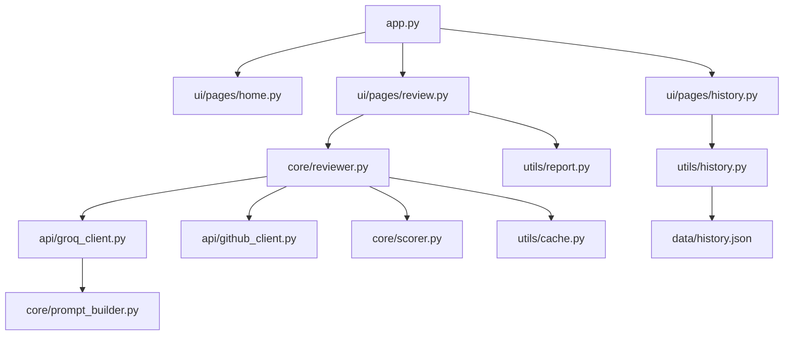

# 🤖 ReviewBot — AI Code Review for Serious Engineers


> Catch bugs, security vulnerabilities, and code smells before they hit production. Powered by LLaMA 3 on Groq — results in seconds, not minutes.

---

## ✨ Features

- ✅ **GitHub + File Upload** — Paste any public GitHub URL or upload a local file
- ✅ **Multi-Language** — Python, JavaScript, TypeScript, Java, C++
- ✅ **Severity Grading** — CRITICAL / WARNING / SUGGESTION with before/after fixes
- ✅ **Health Score** — 0–100 gauge per review with trend tracking
- ✅ **Exportable Reports** — Full Markdown report with one click
- ✅ **Review History** — Compare scores over time with a trend chart
- ✅ **Retry Logic** — Exponential backoff via Tenacity — no flaky reviews
- ✅ **Premium UI** — GitHub Dark theme, zero default Streamlit aesthetics

---

## 🚀 Quick Start

```bash
# 1. Clone the repo
git clone https://github.com/yourusername/reviewbot
cd reviewbot

# 2. Install dependencies
pip install -r requirements.txt

# 3. Add your secrets
cp .env.example .env
# Edit .env and add your GROQ_API_KEY

# 4. Run
streamlit run app.py
```

**Get your free Groq API key:** https://console.groq.com

---

## 🗂️ Architecture



---

## 📸 Screenshots

> _Demo screenshots coming soon_

---

## 🔮 Roadmap

- [ ] **PR Review Mode** — comment directly on GitHub pull requests
- [ ] **Team Workspace** — shared review history with org-level stats
- [ ] **IDE Extension** — VS Code extension for in-editor reviews
- [ ] **Custom Rulesets** — import ESLint/Pylint configs as review context
- [ ] **CI/CD Integration** — GitHub Action that fails builds on CRITICAL issues

---

## 🤝 Contributing

See [CONTRIBUTING.md](CONTRIBUTING.md) for guidelines.
